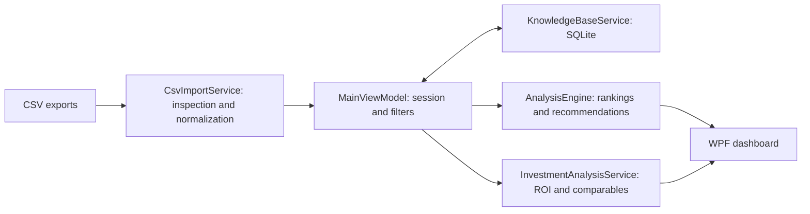

# Turo Car Rental Analyser

A Windows desktop decision-support application that turns car-rental research CSVs into vehicle rankings, comparable listings, revenue trends, and acquisition scenarios.

Built with **C# / .NET 8, WPF, and SQLite**. The project demonstrates data ingestion, feature engineering, explainable ranking, local persistence, and delivery of an interactive analytics product.

## The problem

Rental research exports contain useful signals across inconsistent columns: daily rates, utilization, revenue history, host information, and delivery options. Comparing those signals manually makes it difficult to shortlist vehicles and understand purchase assumptions.

Users import exports, compare market segments, select a vehicle, and explore cash flow under editable acquisition and operating-cost assumptions.

## Features

- Known-header import profile for RentScout/Raptor-style exports, plus a mapping preview for other CSVs.
- Parsing of currency, utilization, ratings, listing metadata, and dynamically detected monthly revenue columns.
- Rankings by model, vehicle type, market, and host, with readable explanations.
- Candidate recommendations using listing performance and stored market baselines.
- Comparable listings matched using location, vehicle characteristics, price, and revenue.
- Revenue history, trend and variability indicators, delivery features, and listing links.
- ROI scenarios covering financing, platform fees, operating costs, cash flow, and break-even estimates.
- Local SQLite storage of imported listings for subsequent comparison.

## Run locally

Requires Windows and the .NET 8 SDK with Windows desktop support.

```powershell
dotnet restore .\TuroCarAnalyser\TuroCarAnalyser.csproj
dotnet run --project .\TuroCarAnalyser\TuroCarAnalyser.csproj
```

Alternatively, double-click `Open-TuroCarAnalyser.bat`. The launcher redirects application data and NuGet caches into ignored folders beside the project; it still requires the SDK.

For a quick demonstration, import the two illustrative CSVs in [SampleData](SampleData). They use different headers to exercise the mapping workflow. Select a listing to explore comparables and ROI. The bundled demos do not include monthly history or host metadata; richer exports populate the Hosts and Seasonality tabs.

## Architecture



The application is a layered desktop monolith with MVVM-style binding. See [architecture and tradeoffs](docs/ARCHITECTURE.md) for details.

## Relevance to AI engineering

The current recommendation engine is **deterministic and rule-based**. It uses normalized signals and weighted scores; it does not train a model, call an LLM, or implement retrieval-augmented generation. The local "knowledge base" is a SQLite listing store.

The AI-relevant engineering work is the foundation: normalizing external data, constructing comparable features, retaining reference data, explaining outputs, and integrating the pipeline into a usable product. A future learned ranker would need independently defined outcomes and a time-based evaluation dataset before it could be compared credibly with this baseline.

## Verification

```powershell
dotnet build .\TuroCarAnalyser\TuroCarAnalyser.csproj --configuration Release
dotnet run --project .\tests\TuroCarAnalyser.SmokeTests\TuroCarAnalyser.SmokeTests.csproj --configuration Release
```

Smoke checks cover demo import, known-export parsing, dashboard generation, and SQLite round-trip persistence using temporary synthetic data. The GitHub Actions workflow runs these checks on Windows. They do not replace manual testing of WPF layout and interactions.

To publish a Windows x64 application folder with the runtime included:

```powershell
dotnet publish .\TuroCarAnalyser\TuroCarAnalyser.csproj -c Release -r win-x64 --self-contained true -o .\artifacts\publish
```

Run `TuroCarAnalyser.exe` from that folder and retain its supporting files.

## Data and limitations

Records are stored in `%LOCALAPPDATA%\TuroCarAnalyser\knowledge-base.db` (or the redirected location when using the launcher). Clearing the visible session does not delete that database. Images are not fetched automatically. External HTTP/HTTPS links open only after confirmation; the destination website may receive your IP address and browser cookies.

Scores use hand-set weights and depend on the imported sample. Exported revenues are estimates, missing months are not evidence of zero revenue, and the variability indicator is not a validated seasonal forecast. Confirm whether source revenue already includes protection-plan deductions before applying ROI fees. Mixed currencies are not converted.

Known-format recognition currently requires all critical headers; a modified export can fall back to manual mapping. Stronger schema-drift validation, missing-data handling, and fee-basis tracking remain priorities. See [the roadmap](docs/ARCHITECTURE.md#next-engineering-steps).

Private exports, local databases, build outputs, and scratch screenshots are excluded from Git. No real host dataset is required for the demo.

See [security and publication checks](SECURITY.md) before sharing this project.
